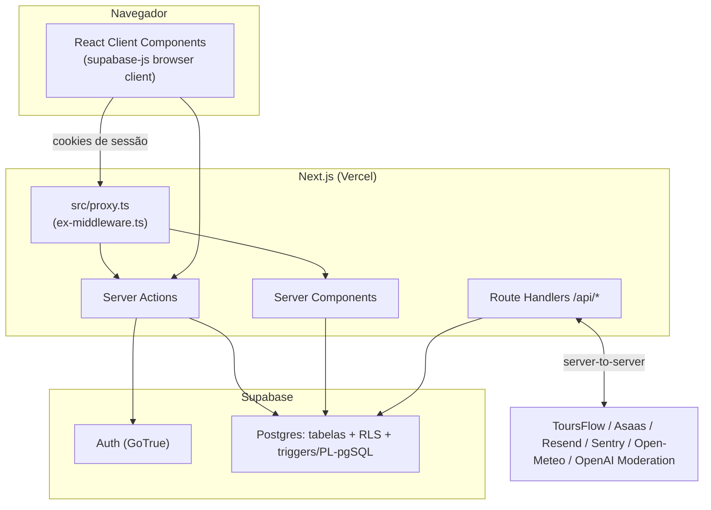

---
tags:
  - nauticflow
  - arquitetura
updated: 2026-09-19
---
← [[00-INDEX]] · relacionado: [[03-stack-e-infraestrutura]] · [[04-banco-e-supabase]] · [[06-seguranca]] · [[08-integracao-toursflow]]

# Arquitetura

## Camadas

Next.js 16 App Router: Server Components fazem a leitura inicial de dados, Server Actions fazem toda escrita (nunca há `insert`/`update` disparado direto do client contra o Postgres fora de RPC explícita), Route Handlers (`src/app/api/`) atendem webhooks, a API pública e a API do marketplace. Ver [[03-stack-e-infraestrutura]] pra versões reais.

## Trust boundaries

- **Nunca confia no client pra dados sensíveis**: `company_id` de um novo registro é sempre lido do perfil do usuário no servidor (via `getProfile()`/sessão), nunca aceito vindo do formulário. Reforçado duas vezes — no app e via RLS/trigger no banco (ver [[04-banco-e-supabase]] e [[06-seguranca]] pra histórico de IDOR corrigidos).
- **Clients Supabase distintos por contexto** (`src/lib/supabase/`): client browser (`client.ts`, anon key, RLS sempre ativo), client server (`server.ts`, por requisição, ainda sob RLS do usuário logado), client middleware (`middleware.ts`, valida sessão via `auth.getUser()` — chamada de rede real, não só leitura de cookie), e um client **admin** (`admin.ts`, `SUPABASE_SERVICE_ROLE_KEY`, ignora RLS) — regra dura: **nunca usar o client admin fora do servidor**, restrito a operações administrativas (convidar/remover usuário, moderação, painel super_admin, webhooks).
- **Regras críticas de negócio vivem no Postgres, não só na UI**: controle de vagas (`check_departure_capacity`, trava `FOR UPDATE`), limite de passageiros, janela de horário de saída, validação de dono de FK entre tabelas (anti-IDOR) — tudo reforçado por trigger, porque validação só no front-end quebra sob concorrência (duas reservas simultâneas pra última vaga) e pode ser contornada chamando a API do Supabase direto. Detalhe completo em [[04-banco-e-supabase]].
- **Segredos server-only nunca alcançam o bundle do cliente**: nenhuma env var sensível tem prefixo `NEXT_PUBLIC_`. Ver [[10-flags-e-variaveis]].

## Realtime

Várias telas usam Supabase Realtime (Postgres Changes) pra atualização automática entre colaboradores da mesma empresa (clientes, embarcações, parceiros, saídas, reservas, passeios) e um canal singleton pro catálogo público consumido pelo ToursFlow. Detalhe por tela em [[07-funcionalidades]], mecanismo de banco em [[04-banco-e-supabase]].

## Multi-tenancy

Isolamento entre empresas vive **no banco** (RLS por `company_id`), não só na aplicação — decisão de arquitetura documentada no README: "se o isolamento vivesse só no código, uma consulta mal escrita vazaria dados de um operador pra outro; com RLS, o banco recusa mesmo que a aplicação erre." `super_admin` é a única role com visão cross-tenant (painel `/admin`), sempre via política de RLS própria gated por `is_super_admin()`. Ver [[05-autenticacao-e-autorizacao]].

## Integração externa

- **ToursFlow** (marketplace): API server-to-server, ver [[08-integracao-toursflow]].
- **Asaas**: cobrança recorrente do SaaS + Pix do marketplace, ver [[08-integracao-toursflow]] e [[09-planos-e-precos]].
- **Resend**: e-mail transacional (voucher, reset de senha, convite).
- **Sentry**: observabilidade de erros.
- **Open-Meteo**: provider de clima/vento (dashboard).
- **OpenAI Moderation API**: moderação de foto de passeio, opcional (ver [[10-flags-e-variaveis]], `IMAGE_MODERATION_MODE`).
